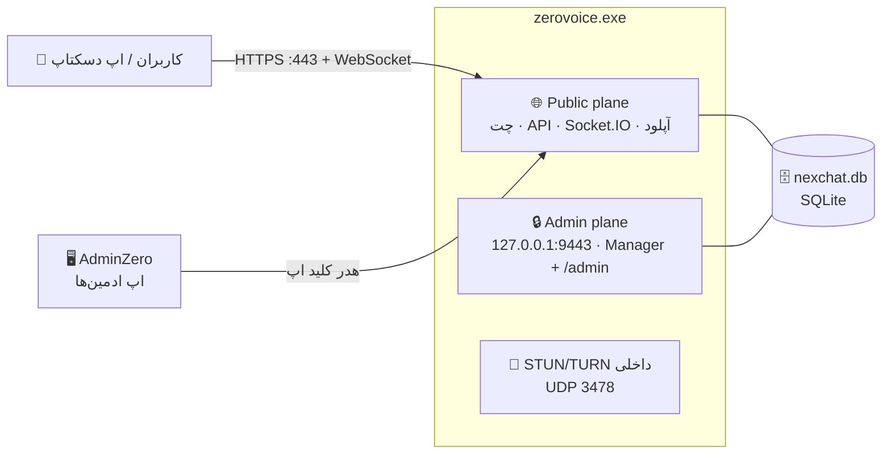

<div align="center">


# ZEROvoice

**سرور چت و تماس صوتی — فقط یک فایل `exe`** ⚡

[](https://go.dev)
[](#-نصب-و-راه‌اندازی)
[](#-معماری)
[](#-معماری)
[](#-سرعت)

**بدون Python · بدون Node · بدون Redis · بدون CGO**

[نصب](#-نصب-و-راه‌اندازی) •
[سرعت](#-سرعت) •
[امنیت](#-امنیت-و-رمزنگاری) •
[ابزارهای مدیریت](#-ابزارهای-مدیریت) •
[مهاجرت](#-مهاجرت-از-نسخه-پایتون)

</div>

<div dir="rtl">

---

## ✨ ZEROvoice چیست؟

`zerovoice.exe` هم **سرور چت و ویس** است و هم **پنل مدیریت (Manager)**. این پروژه بازنویسی کامل سرور پایتونی
(Flask + Socket.IO) و منیجر PyQt به زبان **Go** است، با یک هدف مهم: **سازگاری کامل با نسخه‌ی قبلی**.

> دیتابیس (`nexchat.db`)، کلیدهای `.env`، پروتکل کلاینت و پوشه‌ی `tls/` همان قبلی است.
> کاربران فعلی **بدون تغییر رمز** وارد می‌شوند و اپ دسکتاپ مثل قبل کار می‌کند.

## 🚀 ویژگی‌ها

| | ویژگی | توضیح |
|---|---|---|
| 📦 | **تک‌فایل** | یک `zerovoice.exe` — سرور، منیجر و ابزارهای نگهداری |
| 💬 | **چت لحظه‌ای** | WebSocket با Socket.IO v4، کانال، سرور، DM، رشته‌ها (Thread) و وب‌هوک |
| 🎙️ | **تماس صوتی** | WebRTC همراه با **STUN/TURN داخلی** — نیازی به coturn جدا نیست |
| 🔐 | **HTTPS خودکار** | گرفتن و تمدید گواهی **Let's Encrypt** با ویزارد و تست واقعی |
| 🥷 | **حالت مخفی (Stealth)** | بدون هدر درست، اتصال بی‌هیچ پاسخی قطع می‌شود |
| 🔄 | **آپدیت امن** | آپدیت تأییدشده با SHA-256، پشتیبان قبل از آپدیت و **برگشت خودکار** |
| 💾 | **پشتیبان‌گیری** | بکاپ شبانه (ساعت ۳ بامداد، نگهداری ۱۴ نسخه) و خروجی رمزدار `.zvx` |
| 🛡️ | **پنل ادمین** | پنل مدیریت پنهان از اینترنت + اپ اختصاصی ادمین‌ها (AdminZero) |
| 🩺 | **تشخیص مشکل** | `zerovoice doctor` فایل‌ها، دیتابیس، گواهی و پورت‌ها را چک می‌کند |

## ⚡ سرعت

هاب لحظه‌ای (پخش پیام و صف‌ها) گلوگاه نیست. نتیجه‌ی تست بار با ابزار `zvbench` (کلاینت‌های واقعی WebSocket، همه در یک کانال):

| کلاینت | نرخ پیام | تحویل پیام‌ها | تحویل‌شده | p50 | p99 | p99.9 |
|:---:|:---:|:---:|:---:|:---:|:---:|:---:|
| **300** | 20 پیام/ثانیه × ۱۰ ثانیه | 60,000 | ✅ 100٪ | **4.5 ms** | 8.4 ms | 11.7 ms |
| **2,000** | 50 پیام/ثانیه × ۱۵ ثانیه | 1,500,000 | ✅ 100٪ | **9.9 ms** | 28.6 ms | 48.8 ms |

> ⚠️ **صادقانه:** این اعداد روی یک سندباکس ۲ هسته‌ای لینوکس، با کلاینت و سرور روی **همان ماشین** و HTTP ساده به‌دست آمده‌اند
> (نه Windows، نه Go 1.20، نه درایور نهایی SQLite) و **هنوز مقایسه‌ی مستقیم با نسخه‌ی پایتون انجام نشده**.
> برای عدد واقعی سرور خودت، `zvbench` را روی همان سرور اجرا کن. جزئیات: [`BENCHMARKS.md`](BENCHMARKS.md)

## 📥 نصب و راه‌اندازی

**پیش‌نیاز:** ویندوز ۶۴ بیتی (Server 2012 تا 2022 یا ویندوز 10/11) و اینترنت (فقط برای بار اول).

```text
1. پوشه‌ی پروژه را از زیپ خارج کن            (مثلاً C:\ZEROvoice-src)
2. روی build.bat دوبار کلیک کن
3. R = اجرا در همین پنجره    |    I = نصب به‌صورت سرویس ویندوز (به‌عنوان Administrator)
4. لینک manager که چاپ می‌شود را باز کن     (http://127.0.0.1:9443/?t=…)
5. دامنه را بنویس؛ ویزارد DNS را چک می‌کند، گواهی می‌گیرد و HTTPS را تست می‌کند
```

`build.bat` خودش **Go 1.20.14** را دانلود و با فایل `.sha256` رسمی تأیید می‌کند، پس نیازی به نصب چیزی نیست.

| دستور | کار |
|---|---|
| `build.bat build` | فقط بیلد |
| `build.bat run` | بیلد و اجرا |
| `build.bat install` | بیلد و نصب سرویس + باز کردن پورت‌های ۸۰ و ۴۴۳ |
| `build.bat deploy` | نصب نسخه‌ی جدید با لانچر |
| `build.bat clean` | پاک‌سازی ابزارها و خروجی‌ها |

## 🏗️ معماری



- **Public plane:** پورت `443` (TLS) و `80` (چالش ACME و ریدایرکت).
- **Admin plane:** فقط `127.0.0.1:9443` با توکن؛ **هرگز** به اینترنت باز نمی‌شود.
- ساخته‌شده با **Go 1.20** (آخرین نسخه‌ای که روی Server 2012 اجرا می‌شود)، بدون CGO، با **یک وابستگی خارجی** (`modernc.org/sqlite`).

## 🛠️ ابزارهای مدیریت

| ابزار | کار | مستندات |
|---|---|---|
| **AdminZero** | اپ کوچکی که پنل `/admin` را برای ادمین‌ها باز می‌کند و کلید پنهان را خودش می‌فرستد | [`ADMINZERO.md`](ADMINZERO.md) |
| **Launcher** | اجرای نسخه‌ها کنار هم، سوییچ نرم و برگشت خودکار؛ آپدیت با انداختن فایل در `inbox\` | [`LAUNCHER.md`](LAUNCHER.md) |
| **Manager** | رابط مدیریت سرور (ویزارد دامنه، گواهی، بکاپ، تنظیمات) | [`manager-app/`](manager-app/README.md) |

<details>
<summary><b>📋 همه‌ی دستورها</b></summary>

```text
zerovoice run                      اجرای سرور + منیجر (پیش‌فرض)
zerovoice install | uninstall | start | stop      سرویس ویندوز
zerovoice status | doctor          بررسی فایل‌ها، دیتابیس، گواهی و پورت‌ها
zerovoice backup | restore <file>  پشتیبان دیتابیس (بازیابی با کپی ایمنی)
zerovoice export <f.zvx> -p PW     خروجی رمزدار (AES-256-GCM)
zerovoice import <f.zvx|f.zvstate> [-p PW]
zerovoice import-legacy <dir>      کپی نصب قدیمی پایتون
zerovoice update <file|https-url>  آپدیت تأییدشده + برگشت خودکار
zerovoice rollback                 برگشت به نسخه‌ی قبل
zerovoice cert [--force]           صدور/تمدید فوری گواهی
zerovoice dns <domain>             بررسی اشاره‌ی DNS به همین ماشین
```

</details>

## ⚙️ تنظیمات (`.env`)

همان کلیدهای نسخه‌ی قبلی (فایل در پوشه‌ی داده، کنار `nexchat.db`):

| کلید | کار |
|---|---|
| `ZV_DOMAIN` · `ZV_PORT` · `ZV_HTTP_PORT` | دامنه و پورت‌ها (پیش‌فرض 443 و 80) |
| `ZV_ACME_EMAIL` · `ZV_ACME_STAGING` | تنظیمات Let's Encrypt |
| `ZV_CLIENT_KEY` | کلید حالت مخفی |
| `ADMIN_TOKEN` · `ADMIN_PASSWORD` · `ADMIN_APP_KEY` | ورود به پنل ادمین (رمز ≥ 12 و کلید اپ ≥ 24 کاراکتر) |
| `ZV_TURN_SECRET` | فعال‌سازی STUN/TURN داخلی (UDP 3478) |
| `SECRET_KEY` | کلید امضای نشست‌ها (اگر نباشد `.secret_key` ساخته می‌شود) |
| `ZV_ADMIN_ADDR` · `ZV_NO_BROWSER` | آدرس ادمین و جلوگیری از باز شدن مرورگر |

> 🔥 اگر TURN داخلی را روشن می‌کنی، پورت UDP `3478` و بازه‌ی پورت رله را در فایروال باز کن.

**پوشه‌ی داده** (`--data-dir` یا `ZV_DATA_DIR`؛ پیش‌فرض `C:\ProgramData\ZEROvoice`):

| مسیر | محتوا |
|---|---|
| `nexchat.db` | دیتابیس SQLite |
| `.env` · `.secret_key` | تنظیمات و کلید نشست |
| `settings.json` | تنظیمات منیجر (دامنه، ایمیل، stealth) |
| `tls/` | گواهی، کلید خصوصی و کلید حساب ACME |
| `backups/` · `versions/` · `logs/` | بکاپ‌ها، نسخه‌های قبلی، لاگ‌ها |

## 🔐 امنیت و رمزنگاری

| بخش | روش |
|---|---|
| **ارتباط** | TLS با گواهی خودکار Let's Encrypt |
| **پسورد کاربران** | PBKDF2-HMAC-SHA256 با salt (۲۶۰ هزار دور) و مقایسه‌ی زمان‌ثابت |
| **نشست‌ها** | کوکی امضاشده با HMAC، با امکان ابطال نشست‌ها هنگام تغییر رمز یا بن |
| **پنل ادمین** | فقط loopback، توکن تصادفی، بررسی Host و Origin؛ در حالت عمومی بدون هدر درست پاسخ `404` |
| **تماس صوتی** | WebRTC (DTLS-SRTP) و اعتبارنامه‌ی TURN موقت با HMAC |
| **خروجی و بکاپ `.zvx`** | AES-256-GCM با کلید PBKDF2 (۶۰۰ هزار دور) |
| **آپدیت** | `.sha256` اجباری و امضای ed25519 اختیاری |
| **آپلود** | بررسی محتوا، encode دوباره‌ی تصاویر و حذف EXIF، سهمیه برای هر کاربر |

<details>
<summary><b>⚠️ محدودیت‌های شناخته‌شده (صادقانه)</b></summary>

- پیام‌ها و DMها **رمزنگاری سرتاسری (E2E) نیستند**؛ دیتابیس روی دیسک رمز نشده است.
- `.env` و `.secret_key` روی دیسک رمز نشده‌اند و به دسترسی‌های ویندوز تکیه دارند.
- برای سازگاری با نسخه‌ی قدیمی از HMAC-SHA1 (کوکی و TURN) و MD5 (پروتکل STUN) استفاده می‌شود.
- حداقل نسخه‌ی TLS لیسنر عمومی صریح تنظیم نشده؛ پیشنهاد می‌شود با `nmap --script ssl-enum-ciphers` بررسی شود.

جزئیات بیشتر: [`SECURITY.md`](SECURITY.md) و `docs/RISKS.md`

</details>

## 🔁 مهاجرت از نسخه‌ی پایتون

```bash
zerovoice import-legacy "C:\مسیر\نصب-قدیمی"
```

دیتابیس، `.env`، کلید نشست، گواهی‌ها و آپلودها کپی می‌شوند. **لازم نیست کاربرها رمزشان را عوض کنند** و نشست‌های فعلی معتبر می‌مانند.
راهنمای کامل: [`MIGRATION.md`](MIGRATION.md)

## 🧪 توسعه

```bash
go test ./...                       # تست‌ها
go run ./tools/goapicheck ./...     # خطا می‌دهد اگر API جدیدتر از Go 1.20 استفاده شود
go run ./cmd/zvbench -h             # تست بار
```

مستندات فنی در پوشه‌ی `docs/` است: `SPEC` · `ARCHITECTURE` · `INTERFACES` · `DECISIONS` · `TEST_PLAN` · `RISKS`.

## 📝 نکته‌ی صادقانه

کد در محیط تست لینوکسی با درایور جایگزین SQLite آزمایش شده و همه‌ی تست‌ها سبزند. اجرای واقعی روی ویندوز Server 2012 با Go 1.20،
سرویس ویندوز و گواهی واقعی Let's Encrypt بار اول روی سرور خودت تست می‌شود. فهرست کامل موارد در `docs/DECISIONS.md` (بخش «Known gaps») آمده است.

---

<div align="center">

ساخته‌شده با ❤️ و Go

</div>

</div>
